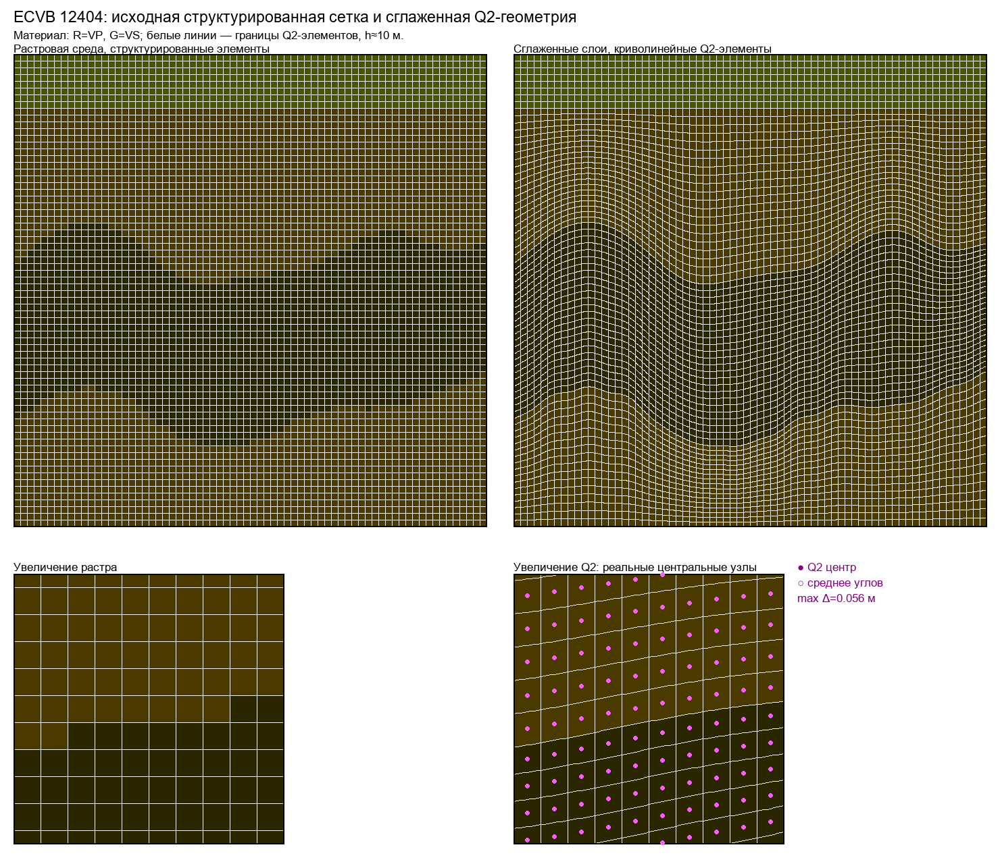
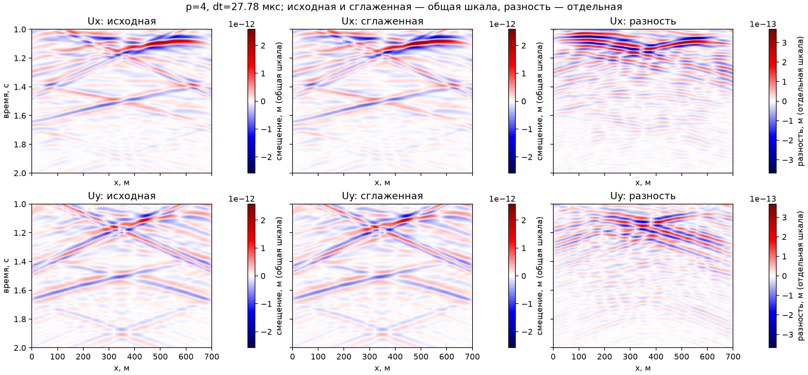

> Исторический протокол/отчёт перенесён из TrySEMGPU. Навигационные ссылки обновлены; численные результаты и исходные JSON не пересчитывались. Актуальные команды и ограничения — в summary главы 1.2.

# Сглаживание ECVB 12404: пилот SEM на Windows CPU-gen

Дата: 2026-11-04. Статус: все десять расчётов завершены успешно до t=2 с. Это исследовательский результат, не полная приёмка Windows-версии решателя.

Сглаживание этой модели существенно меняет слабые поздние волны. На участке 1–2 с относительная разность сейсмограмм составляет около 18,48% по Ux и 16,08% по Uy; поле при t=2 с различается примерно на 14–15%. Эти эффекты значительно превосходят оценённые численные поправки. Полная запись, в которой доминируют сильные ранние волны, различается лишь на 0,84%/0,51%; для столь малого общего эффекта выбранный строгий пятикратный запас относительно суммарной пространственной поправки не достигнут.

## Постановка

Сравнивается одна исходная модель ECVB и её сглаженная версия. Контроль — SEM на исходных 70×70 квадратах 10×10 м, с точными исходными материалами в ячейках. Вторая сетка согласована с гладкими границами четырёх слоёв и содержит те же 4900 четырёхугольников. Геометрия каждого элемента — полная Q2, включая центральный узел; при повышении порядка решения геометрическая карта фиксирована. Это специализированная блочная сетка выбранной слоистой модели, не общий генератор неструктурированных сеток для всех ECVB.

Модель 12404 выбрана среди 30000 ECVB по отсутствию мелких областей, одинаковой последовательности материалов во всех столбцах и большой минимальной толщине слоя — 80 м. Отбор намеренно ищет удобный случай. Строгому условию одинаковой последовательности без изменения исходной топологии отвечают только 90 моделей; при минимальной толщине 40 м остаётся 12. Поэтому данный пример не является статистической выборкой ECVB.

| Слой сверху | VP, м/с | VS, м/с |
| --- | ---: | ---: |
| 1 | 1993 | 975,97681 |
| 2 | 2365 | 1158,14612 |
| 3 | 2365 | 1406,69336 |
| 4 | 2365 | 1158,14612 |

Верхняя граница материалов горизонтальна и сохраняется. На двух изгибающихся интерфейсах меняется только VS; VP с обеих сторон одинаков. Этот опыт проверяет сглаживание сдвиговых контрастов. Материал меняется на площади 3354,177 м², или 0,684526% области; максимальные смещения границ с учётом краёв растровых ступенек — 8,431 и 7,277 м. Вертикальные размеры криволинейных элементов — 7,019–13,529 м. Положительность якобиана доказана аналитически для всей Q2-карты каждого элемента.



Плоская деформация, постоянная плотность 1000 кг/м³, свободная верхняя поверхность, ABC по бокам и снизу. Материал внешних границ сохраняется благодаря закреплённым концам сплайнов. Источник по уточнению пользователя — вертикальная сила, а не заданное перемещение из исходного письма: центр x=350 м на поверхности, профиль гауссианы на [345;355] м, sigma=5/3 м, за пределами пятна ноль. То есть 10 м здесь трактуются как полная ширина носителя ±3 sigma. Суммарная сила направлена вниз и нормирована до 1 Н на единицу толщины; временная форма — Рикер 15 Гц с центром 0,1 с. Согласованная нагрузка интегрируется по функциям формы, а её физические параметры одинаковы при всех порядках.

На поверхности записаны Ux и Uy в 71 приёмнике x=0,10,…,700 м через 1 мс. Полный массив содержит 2001 момент от 0 до 2 с включительно; NPZ также содержит совместимый с письмом срез из 2000 моментов 0–1,999 с. Поля сохранены в t=0,2;0,5;1;2 с на общей физической сетке центров 70×70 исходных ячеек.

## Нативный Windows-маршрут

Расчёты выполняет установленный `semgpu2.solvers.lin_elast_2d_tenzor_newmark_kim_ceed` с ресурсом `/cpu/self/gen`, без WSL и GPU. Подготовлены Windows core/JIT patches для закреплённого libCEED `58fb7cf9cc988cc190de4beabbda3bf438bccae7`, CMake-сборка DLL и import library, установочные JIT-заголовки и поддержка загрузки из Python. Исправлена коллизия выходных import libraries четырёх `_native` targets при параллельной сборке. Использованы clang-cl 22.1.8, MSVC/SDK и проектная Python 3.13.15.

Чистая отдельная сборка CEED, ABI probe и реальная CPU-gen JIT DLL проверены. В малой задаче на криволинейной Q2-сетке gen и ref дали относительную L2-разность 1,38e-18; это контроль Windows/JIT-маршрута, не независимый физический oracle для всей сейсмической задачи. Полная матрица Linux/CUDA/3D не запускалась. Инструкция: [Build environment, §19](../../../../SEM/TrySEMGPU/docs/BUILD_RUN_ENVIRONMENT.md#ceed-windows-cpu-p113); [отчёт сборки](../../../../SEM/TrySEMGPU/work/explore/windows_ceed_port_report.md); [численный probe](../../data/dev_1_2_smoothing/windows_tensor_probe_evidence.json).

Вся сейсмическая серия использует одну DLL SHA256 `84f50925453828644871feec9a81c768e98843039a70c3e36b04524d50f4d216` и один `_native.pyd` SHA256 `ec09ec361a5b26fa1934e99dedf525b24bdd58a01c17d6eda9f2a3496c252a81`. Свежая проверочная сборка из отдельного prefix имеет другой SHA256 и не подменяет библиотеку в середине серии. Каждый запуск сохраняет собственный provenance, геометрию идентифицируют hashes узлов; библиотека и сценарии между случаями не менялись.

Дополнительно сохранён [manifest JIT-заголовков](../../data/dev_1_2_smoothing/pilot_runs/jit_header_manifest.json). Реальный сгенерированный C++ operator включает установленный `common/ceed/actions.h`; его SHA256 совпадает с исходным файлом проекта. Это важно, поскольку CPU-gen компилирует физические kernels во время выполнения.

## Определения и проверки

В таблицах используется дискретная относительная L2-норма по всем приёмникам и выбранным моментам времени, отдельно для Ux/Uy. Для геометрического сравнения знаменатель — исходная среда; для уточнения порядка или шага — более точный вариант. Окна времени нормируются на исходный сигнал внутри своего окна. Поэтому 16% поздней коды не означают 16% от амплитуды всей записи. Дополнительно в JSON сохранены абсолютные нормы, максимальные разности и показатели вне 20 м от источника.

Шаг 1/18 мс общий для p=2,3,4, контроль времени на p=4 использует 1/36 мс. Основная пара с прямой проверкой времени — p=4 на шаге 1/36 мс; p=5 на том же шаге служит более точным пространственным контролем. Его шаг удовлетворяет консервативной оценке устойчивости. Проверка полного Q2-представления для p=5 дала максимум отклонения координат 4,55e-13 м; суммарная сила и первые два пространственных момента совпали с аналитическими интегралами гауссианы. Узловые hashes проверенных сеток совпали с реально запущенными p5-случаями.

Рабочий критерий пространственного/временного уточнения — менее 1% по каждой компоненте. Для атрибуции эффекта сглаживанию используется дополнительное сравнение с суммой норм изменений обоих отдельных решений; устойчивость разности G=curved−raster рассматривается отдельно и не подменяет этот критерий. Конечная последовательность p не даёт строгой верхней границы ошибки. Прямое уточнение времени выполнено на p=4; оно не называется прямой временной проверкой p=5.

## Промежуточные результаты p=4

| Сравнение | Полная запись Ux, % | Полная запись Uy, % | 1–2 с Ux, % | 1–2 с Uy, % |
| --- | ---: | ---: | ---: | ---: |
| Исходная: p3→p4 | 0,302702 | 0,778335 | 0,367004 | 0,555531 |
| Сглаженная: p3→p4 | 0,303033 | 0,778334 | 0,593773 | 0,755545 |
| Исходная: dt→dt/2 | 0,003378 | 0,002948 | 0,018563 | 0,022375 |
| Сглаженная: dt→dt/2 | 0,003384 | 0,002949 | 0,018501 | 0,021955 |
| Сглаженная минус исходная, p4 | 0,839825 | 0,509000 | 18,478808 | 16,078017 |

Уже на p=4 поздняя кода различается значительно сильнее, чем при уточнении порядка или времени. Однако по полной записи вертикальная пространственная поправка ещё сопоставима с геометрическим эффектом, поэтому выполняется p=5. Полная сейсмограмма преимущественно определяется сильными ранними волнами: норма участка 1–2 с составляет лишь 2,75%/1,47% от нормы полной записи Ux/Uy. Общий показатель менее 1% без отдельного анализа коды скрыл бы важную часть результата.

Промежуточные машинные метрики и изображения сохранены отдельно: comparison_p4/metrics.json (`pilot_runs/comparison_p4/metrics.json`, исторический файл отсутствует локально).

## Итоговая пространственная проверка и эффект геометрии

| Сравнение на шаге 1/36 мс | Полная запись Ux, % | Полная запись Uy, % | 1–2 с Ux, % | 1–2 с Uy, % |
| --- | ---: | ---: | ---: | ---: |
| Исходная: p4→p5 | 0,152266 | 0,105948 | 0,084717 | 0,123916 |
| Сглаженная: p4→p5 | 0,152251 | 0,105947 | 0,078343 | 0,119440 |
| Геометрия, p4 | 0,839826 | 0,509000 | 18,479151 | 16,078430 |
| Геометрия, p5 | 0,839580 | 0,509011 | 18,479696 | 16,081990 |

Критерий 1% выполнен для обеих компонент, обеих сред, всех четырёх временных окон и приёмников вне 20 м от источника. Прямой временной контроль p4 также проходит его с большим запасом. Для поля при t=2 с поправки p4→p5 составляют 0,02731%/0,03459% у исходной среды и 0,03549%/0,04490% у сглаженной. Поэтому дальнейшего повышения порядка для поставленной оценки картины волн не требуется.

Строгая диагностика использует отношение нормы геометрической разности к сумме норм поправок каждого решения: G / (||r5−r4|| + ||c5−c4||), без предположения о сокращении общей ошибки. По полной записи это отношение равно 2,76/2,40, ниже заданного порога 5. Поэтому значения 0,84%/0,51% являются наблюдаемыми малыми различиями, а не результатом с выполненным пятикратным запасом по пространственной погрешности. Сама разность G при повышении порядка меняется лишь на 0,115%/0,136% от своей нормы; это полезное дополнительное наблюдение, но оно не заменяет основную диагностику.

Для участка 1–2 с отношение эффекта к сумме пространственных поправок равно 109,60/65,01. Для поля при t=2 с — 221,17/181,82. Здесь запас велик; заметное изменение поздних волн уверенно отделяется от наблюдаемой численной погрешности. Временные поправки на p4 ещё меньше: около 0,02% в поздней коде.



На изображении первые две колонки используют одну цветовую шкалу. Разность в третьей колонке имеет собственную, усиленную шкалу. [Полная запись](../../img/dev_1_2_smoothing/pilot_runs/comparison/seismograms_p4.png), [проверка p5](../../img/dev_1_2_smoothing/pilot_runs/comparison/seismograms_late_p5.png), [поздние поля](../../img/dev_1_2_smoothing/pilot_runs/comparison/snapshots_late_p5.png), [сходимость](../../img/dev_1_2_smoothing/pilot_runs/comparison/convergence_p.png), [все численные метрики](../../data/dev_1_2_smoothing/pilot_runs/comparison/metrics.json).

| Момент поля | Разность сред Ux, % | Разность сред Uy, % |
| --- | ---: | ---: |
| 0,2 с | 0,08278 | 0,10208 |
| 0,5 с | 1,94183 | 3,62516 |
| 1 с | 10,50506 | 9,60529 |
| 2 с | 13,94981 | 14,55042 |

Таблица поля относится к p5, общей сетке физических точек и норме исходного поля в соответствующий момент. Позднее поле слабее раннего, поэтому его относительная разность не равна такой же доле максимальной амплитуды за весь расчёт.

## Что это означает для векторизации

Для выбранного простого случая сплайновая модель и согласованная Q2-сетка практически осуществимы. Повышение порядка подтверждает устойчивость наблюдаемого изменения картины поздних волн. Сглаживание следует считать изменением физической модели среды: малость изменённой площади не гарантирует малость изменения слабых отражённых и рассеянных сигналов. При оценке пригодности такого датасета нужно задавать допуск для интересующих волновых событий, а не только для общей нормы записи. По этому пилоту нельзя переносить количественные проценты на все ECVB.

## Выполненные расчёты

| Порядок решения | Шаг, мкс | Узлов | Исходная, с | Сглаженная, с |
| --- | ---: | ---: | ---: | ---: |
| 2 | 55,556 | 19881 | 147,61 | 161,07 |
| 3 | 55,556 | 44521 | 456,87 | 514,99 |
| 4 | 55,556 | 78961 | 914,03 | 890,26 |
| 4 | 27,778 | 78961 | 1950,66 | 1943,38 |
| 5 | 27,778 | 123201 | 2788,33 | 2801,87 |

Все случаи имеют 4900 элементов, 2 с моделируемого времени, успешный runtime result, конечные массивы и полные записи. Времена включают prepare/JIT и run на Intel Core i5-1240P; несколько процессов выполнялись одновременно. Это фактические затраты пилота, не изолированный benchmark производительности.

## Воспроизведение и границы

[Протокол](pilot_geometry/PROTOCOL.md) фиксирует команды, параметры и ограничения. `pilot_windows.py` удерживает DLL search-directory handle весь запуск; его следует вызывать из VS x64 developer shell. `pilot_compare.py` читает только завершённые результаты и проверяет одинаковые физические параметры, временные/пространственные координаты, runtime result и hashes пяти входных файлов. `pilot_verify_order.py` независимо проверяет Q2-карту и моменты нагрузки. Mypy изменённых исследовательских сценариев прошёл; промежуточные нормы пересчитаны отдельным NumPy-выражением, PNG просмотрены.

Итоговые нормы p4/p5 повторно вычислены другим агентом непосредственно из NPZ без изменения кода и совпали с отчётом. Ссылки и десять итоговых PNG проверены. [Manifest результата](../../data/dev_1_2_smoothing/pilot_runs/comparison/manifest.json) содержит контрольные суммы сырых результатов, сценариев и итоговых изображений. Эти проверки не придают исследовательскому пилоту статус формальной приёмки solver.

Применены `agents/skills/MYPY_CHECK_SKILL.md` и `agents/skills/CHANGELOG_WRITE_SKILL.md`; собственные persistent изменения записаны в Research-раздел `CHANGELOG.md`. Git commit/push не выполнялись.

Повторить только постобработку без численных запусков из корня проекта можно следующими командами; выходной каталог должен быть новым:

```powershell
$pilotRuns = "research/seismic_dataset/pilot_runs"
$comparisonArgs = @()
foreach ($pilotKind in @("raster", "curved")) {
    foreach ($pilotOrder in @(2, 3, 4)) {
        $comparisonArgs += @("--${pilotKind}-p${pilotOrder}", "$pilotRuns/${pilotKind}_p${pilotOrder}_s18")
    }
    $comparisonArgs += @("--${pilotKind}-p4-s36", "$pilotRuns/${pilotKind}_p4_s36")
    $comparisonArgs += @("--${pilotKind}-p5", "$pilotRuns/${pilotKind}_p5_s36")
}
& .\.venv\Scripts\python.exe scripts/dev_1_2_smoothing/pilot_compare.py @comparisonArgs --out "$pilotRuns/comparison_repeat"
```

Выводы относятся к одной специально выбранной модели, одному силовому источнику и указанным ABC. Изменение слабой коды включает отклики конечной области с этими поглощающими условиями; в пилоте не выполняется отдельная идентификация каждой волновой фазы. Переход к общему ECVB с включениями, выклиниванием слоёв и контрастами VP требует других геометрических случаев. По этим двум сеткам одинакового числа элементов не измеряется выигрыш от сокращения числа элементов или производительность на GPU.
