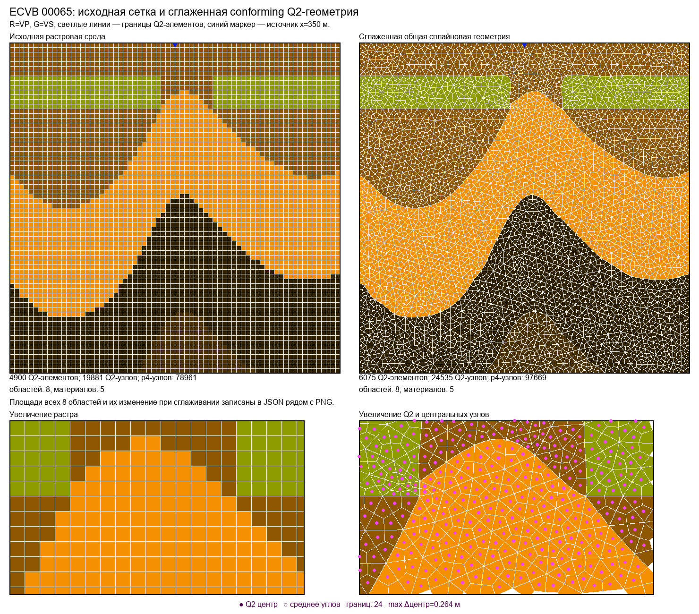
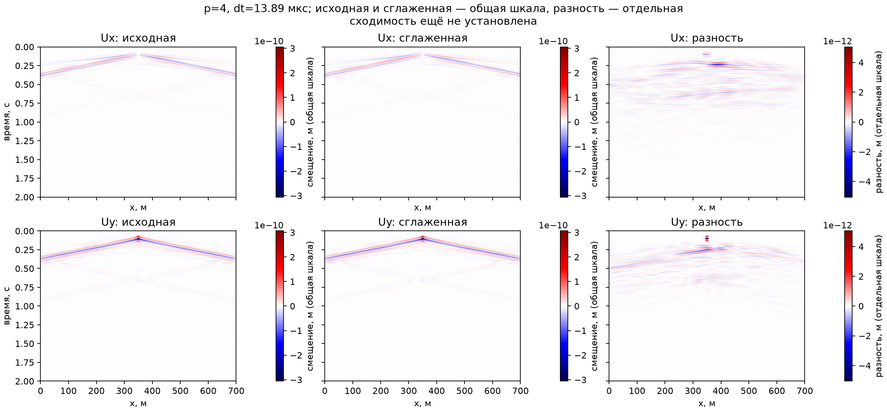
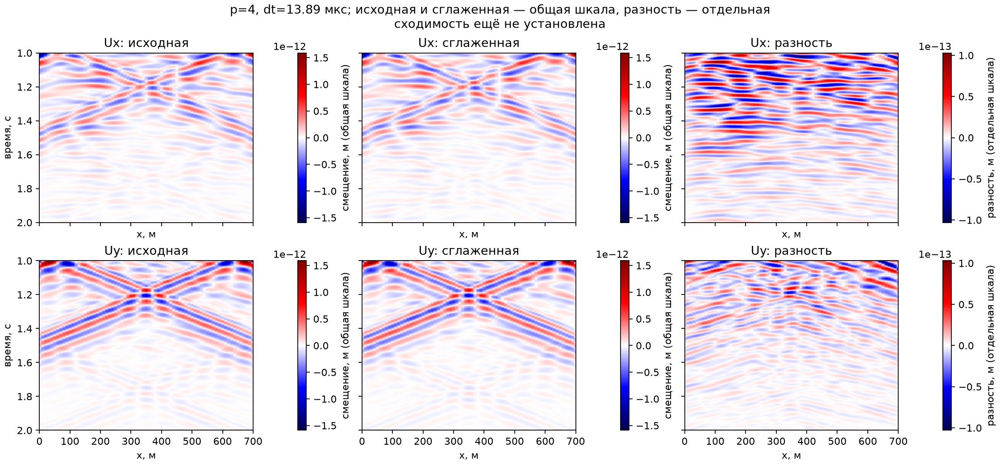
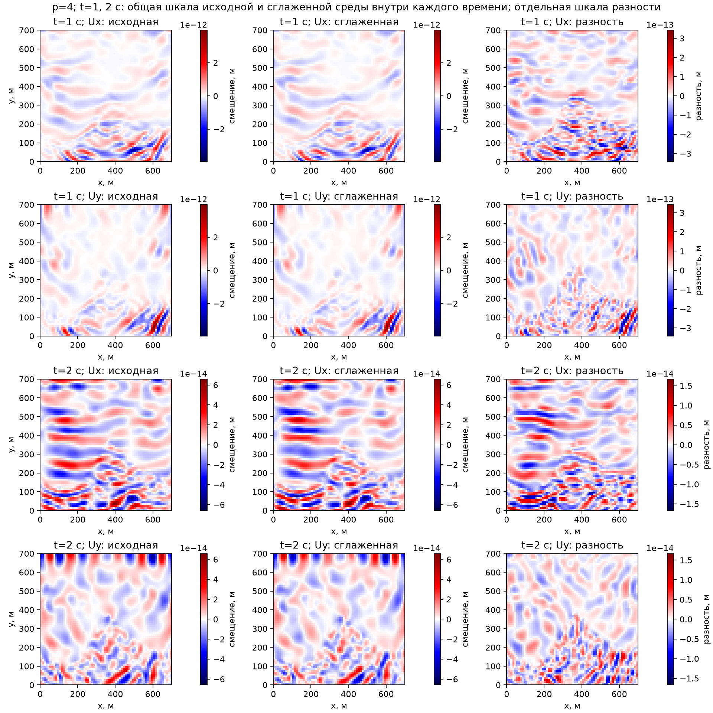

> Исторический протокол/отчёт перенесён из TrySEMGPU. Навигационные ссылки обновлены; численные результаты и исходные JSON не пересчитывались. Актуальные команды и ограничения — в summary главы 1.2.

# ECVB 00065: сравнение исходной и сглаженной среды при p=4

Дата завершения: 2026-11-05, Europe/Moscow. Оба расчёта выполнены до 2 с нативным Windows-решателем `lin_elast_2d_tenzor_newmark_kim_ceed` на `/cpu/self/gen`. Основные поверхностные записи визуально близки: их относительная разность составляет 2,23% по Ux и 1,37% по Uy. В слабых поздних волнах и полях относительные различия существенно больше. Это наблюдение для одной пары p4; отдельная серия сходимости для №65 не выполнена.

## Что сравнивалось

Исходная среда — точный растр 70×70 ячеек по 10 м. Сглаженная — тот же набор пяти материалов в восьми связанных областях с общими сплайновыми границами. Топология материала сохранена, включая короткий контакт длиной 10 м и все особые стыки. После сглаживания материал сменился приблизительно на 1,043% площади, по классификации с шагом 1 м; при шаге 2 м оценка равна 1,025%. Фактическая Q2-граница отклоняется от CAD-сплайна не более чем на 7,27 см на проверенных точках.

| Параметр | Исходная | Сглаженная |
| --- | ---: | ---: |
| Четырёхугольные элементы | 4900 | 6075 |
| Глобальные узлы решения p4 | 78961 | 97669 |
| Геометрические узлы Q2 | 19881 | 24535 |
| Медиана корня площади элемента, м | 10 | 9,09 |
| Время prepare + run, мин | 87,0 | 100,2 |

Времена получены при параллельном запуске на этой машине и не являются отдельным тестом производительности. Геометрия фиксирована как полная Q2-карта, включая центральные узлы. Положительность якобиана проверена на всей площади каждого элемента, а координаты p4 — на совпадение с Q2-картой. Физика, источник, приёмники и временной шаг одинаковы: плоская деформация, ρ=1000 кг/м³, верх свободен, ABC на боках и дне; вертикальная сила Рикера 15 Гц в гауссовом пятне [345,355] м; 144000 шагов по 13,8889 мкс. Подробности и команды — в [протоколе](PROTOCOL.md).

## Наблюдаемые различия

В таблицах используется норма по одинаковым отсчётам: \(D=\|u_{curved}-u_{raster}\|_2/\|u_{raster}\|_2\). Это относительная разность двух вычисленных решений, а не оценка ошибки каждого из них относительно точного решения.

| Поверхностная запись | Ux | Uy |
| --- | ---: | ---: |
| Весь интервал 0–2 с | 2,228% | 1,367% |
| 0–2 с, приёмники не ближе 20 м от источника | 2,147% | 1,225% |
| 0–0,2 с | 0,731% | 1,018% |
| 0,2–0,5 с | 2,396% | 1,494% |
| 0,5–1 с | 9,489% | 4,190% |
| 1–2 с | 13,745% | 6,231% |

| Снимок поля на общей сетке 70×70 | Ux | Uy |
| --- | ---: | ---: |
| t=0,2 с | 2,594% | 1,484% |
| t=0,5 с | 10,317% | 9,509% |
| t=1 с | 12,684% | 10,263% |
| t=2 с | 26,072% | 22,022% |

Поздняя запись слабее основной: норма исходной поверхности в окне 1–2 с составляет только 1,85%/1,44% от нормы полной записи Ux/Uy. Максимум исходного Uy на поверхности равен 3,02e-10 м, а в последних 0,1 с — 6,42e-14 м. В обеих средах нормы снимков убывают; признаков конечного, но растущего сигнала в этих диагностиках не обнаружено. Поэтому большие поздние относительные проценты следует читать вместе с абсолютными шкалами.

На рисунках исходная и сглаженная среды имеют общую шкалу. Разность показана на отдельной, более чувствительной шкале. Для поздних полей общая шкала выбирается отдельно на каждом времени. Также сохранены [все снимки с одной общей шкалой](../../../img/dev_1_2_smoothing/model65/comparison/snapshots_p4.png) и [общий обзор разности](../../../img/dev_1_2_smoothing/model65/comparison/geometry_difference_p4.png).

## Интерпретация и пределы

Для №65 удалось построить полностью четырёхугольную криволинейную сетку и пройти весь расчёт без удаления областей или контактов. Изменение примерно 1% площади материала сопровождается умеренным изменением полной сейсмограммы и заметным изменением слабых рассеянных волн. По полной записи наблюдаемая разность больше, чем в первом опыте №12404; по поздней поверхностной записи она меньше. Сложность геометрии сама по себе не задаёт величину изменения каждого наблюдения.

Точное отделение эффекта сглаживания от дискретизации здесь ещё не выполнено: два варианта имеют разные формы и числа элементов, а для №65 рассчитана только пара p4 с одним временным шагом. Пространственные поправки p4→p5 и контроль Δt из опыта №12404 не переносятся на эту модель автоматически. Даже одинаковые аналитические моменты источника не делают его конечномерное представление тождественным. Для количественного вывода о чистом эффекте сглаживания нужна отдельная серия сходимости на этих двух фиксированных Q2-геометриях.

## Проверки и данные

Scoped mypy прошёл для шести новых research-сценариев и вспомогательных аудиторов. Проверены положительность Q2-якобиана, общие рёбра и покрытие квадрата, восемь связных областей, исходные контакты, Q2→p4 embedding, аналитические моменты силы и консервативная граница временного шага. Оба solver-запуска вернули `TIME_END` после 144000 шагов. В каждом архиве 2001×2×71 поверхностных значений и 4×2×70×70 значений поля; массивы конечны, координаты и моменты записи совпадают.

Отдельный NumPy-аудитор, не импортирующий основную постобработку, получил те же относительные нормы и проверил актуальные SHA256 всех 11 provenance-файлов каждого прогона. Основной результат — [comparison/report.json](../../../data/dev_1_2_smoothing/model65/comparison/report.json), отдельный пересчёт и амплитудные диагностики — [result_audit.json](../../../data/dev_1_2_smoothing/model65/result_audit.json). Просмотрены все PNG сравнения и рисунок сеток. Это исследовательские проверки, а не формальная приёмка решателя.

Исходные массивы: поверхность (`runs/raster_p4_s72/surface.npz`, исторический файл отсутствует локально), поля (`runs/raster_p4_s72/fields.npz`, исторический файл отсутствует локально), [метаданные](../../../data/dev_1_2_smoothing/model65/runs/raster_p4_s72/metadata.json). Сглаженная среда: поверхность (`runs/curved_p4_s72/surface.npz`, исторический файл отсутствует локально), поля (`runs/curved_p4_s72/fields.npz`, исторический файл отсутствует локально), [метаданные](../../../data/dev_1_2_smoothing/model65/runs/curved_p4_s72/metadata.json). Журналы находятся рядом с массивами; контрольные суммы результатов и скриптов собраны в `manifest.json`. Проверенные JIT-заголовки совпали с первым опытом: [jit_header_manifest.json](../../../data/dev_1_2_smoothing/model65/jit_header_manifest.json).
