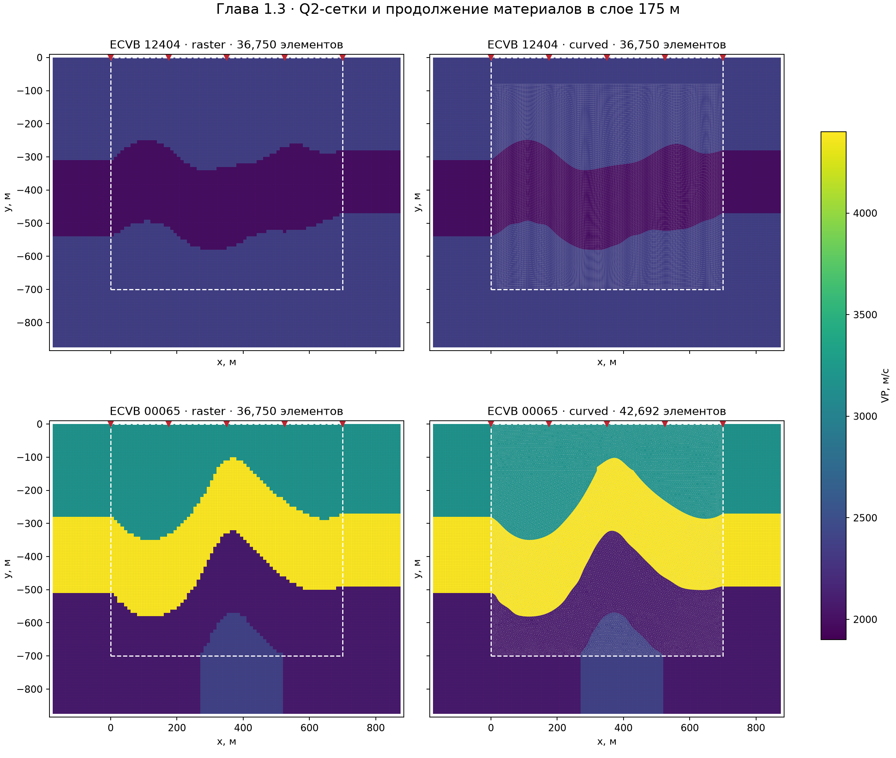

# 1.3. Расширенные сетки и исходная оценка шага

Дата: 13 ноября 2026 года. Построены четыре расширенные сетки и проверены восемь вложений геометрии в GLL p4/p5. Сохранённое [свидетельство проверки](../../data/dev_1_3_point_source/meshes_v1/validation.json) имеет статус `passed` и `native_solver_executed=false`: построение и проверка сеток выполнены без нативного решателя. Этот отчёт описывает геометрию и стартовые оценки шага, а не результаты распространения волн, временную сходимость или независимую валидацию решателя.

## Геометрия и продолжение материалов

Основная область [0,700]×[−700,0] м окружена слоем 175 м слева, справа и снизу. Внешний прямоугольник [−175,875]×[−875,0] м имеет площадь 918750 м². Ось y направлена вверх; верх y=0. Основная верхняя грань содержит ровно 140 прямых рёбер по 5 м; полный верх со слоями содержит 210 рёбер. Всего у каждой сетки 770 внешних рёбер, из которых 560 относятся к бокам и дну для ABC. На границах исходного квадрата внешних рёбер нет: слой согласован с основной сеткой.

Слой построен экструзией граничных Q2-рёбер основной области с шагом 5 м в направлении наружу. Боковой материал продолжается горизонтально, нижний — вертикально, а нижние углы заполнены соответствующим угловым материалом. Метки и VP/VS наследуются от владельца граничного ребра; усреднения материалов на интерфейсах нет. У криволинейной №12404 высоты элементов бокового слоя следуют высотам примыкающих граничных рёбер, поэтому требование ровного шага 5 м относится к верху, а не ко всем направлениям всех криволинейных элементов.

На рисунке белая пунктирная линия обозначает исходный квадрат, красные отметки — пять источников. Цвет показывает VP, поэтому разные материалы с одинаковым VP могут иметь одинаковый цвет; это особенно существенно для №12404. Сетка отображает геометрию, а цветовая карта не заменяет полный набор VP/VS.

## Четыре замороженные Q2-сетки

- ECVB 12404, raster: 36750 элементов, 147771 геометрический Q2-узел; 589541 узел p4 и 920676 узлов p5. Нижняя сертифицированная граница detJ — 6,249999999992333 м²; размер √площади каждого элемента — 5 м с точностью округления.
- ECVB 12404, curved: 36750 элементов, 147771 геометрический Q2-узел; 589541 узел p4 и 920676 узлов p5. Нижняя граница detJ — 4,386461145217807 м²; диапазон √площади — 4,1894–5,8158 м. Основная сетка получена точным ограничением прежней замороженной Q2-карты на четыре дочерних элемента.
- ECVB 00065, raster: 36750 элементов, 147771 геометрический Q2-узел; 589541 узел p4 и 920676 узлов p5. Нижняя граница detJ — 6,249999999992333 м²; элементы основной области являются четырьмя равными дочерними элементами каждого прежнего растрового квадрата.
- ECVB 00065, curved: 42692 элемента, 171539 геометрических Q2-узлов; 684613 узлов p4 и 1069226 узлов p5. Нижняя граница detJ — 0,9620395469556922 м²; диапазон √площади — 2,7742–5,6039 м, медиана 4,7326 м.

Координаты всех GLL-узлов p4 и p5 вычисляются из одной и той же сохранённой Q2-карты каждого варианта. Объединение узлов соседних элементов выполняется по общей топологии вершин и рёбер; отдельно проверяется согласование координат на общих рёбрах. Пять источников x=0,175,350,525,700 м и все 141 приёмник x=0,5,…,700 м найдены однозначно при обоих порядках с допуском 10⁻⁹ м. По построению эти точки являются вершинами верхних элементов, а не интерполированными приёмниками между узлами.

## Новая сглаженная сетка №65

Историческая сетка №65 не имела требуемой равномерной разбивки верха; её полные массивы локально отсутствуют. Новая сетка построена по сохранённому общему CAD-графу интерфейсов `curves.json`, с теми же сплайнами, вершинами и восемью областями. Использован Gmsh 4.15.2, алгоритм Frontal-Delaunay 6, размер исходной треугольной сетки 12,5 м. На прямых внешних CAD-сегментах закреплена разбивка по 10 м, после деления каждого треугольника на три четырёхугольника получены внешние рёбра по 5 м. Конечная расчётная сетка состоит исключительно из полных девятиузловых Q2-четырёхугольников; центральные узлы учитывают кривизну рёбер.

Это новое Q2-приближение прежнего CAD, а не точное дробление исторической криволинейной сетки №65. Его нельзя объявлять побитово или геометрически тождественным исторической Q2-карте. Для новой пары p4/p5 геометрия заморожена и одинакова, но при сопоставлении с главой 1.2 изменение Q2-приближения является дополнительным фактором. Прежняя выборочная оценка расстояния от Q2-рёбер до CAD не переносится на эту сетку; отдельная новая оценка этого расстояния в текущем свидетельстве отсутствует.

Сохранённая проверка подтверждает одну связную компоненту в каждой из восьми областей, совпадение набора десяти контактирующих пар регионов raster/curved и длину короткого контакта материалов 3/4: 10,000000000000004 м. Состав и координаты особых CAD-стыков сохраняются самим построителем, однако отдельная запись проверки всех тройных и четырёхсторонних стыков не включена в `validation.json`; проверку связности и контактных пар не следует выдавать за такую запись.

## Что удостоверяет проверка сеток

Для detJ каждой Q2-карты получены коэффициенты в тензорном базисе Бернштейна степени 3×3. Все нижние границы положительны уже без рекурсивного разбиения. Это проверка на всей площади элемента, а не только в узлах квадратуры. Дополнительно проверены согласование геометрических середин общих рёбер, противоположный обход каждого внутреннего ребра, отсутствие рёбер с более чем двумя владельцами, принадлежность каждого одностороннего ребра внешнему прямоугольнику и эйлерова характеристика 1.

Интегральная площадь каждой сетки равна 918750 м² с погрешностью округления. Положительный якобиан, согласованная топология и правильная площадь не измеряют погрешность решения волнового уравнения. Минимум √площади также не является минимальным направленным размером элемента: в искривлённых или вытянутых ячейках шаг должен определяться полной картой и материалом, а не одним скалярным размером.

При проверке реализации формул согласованы порядок индексов y-major/x-fast в `build_sem`, производные `tensor_basis`, преобразование через обратный якобиан и использование инженерной сдвиговой деформации в B. Дополнительная интерактивная проверка воспроизведения градиентов линейных координат использовалась при ревью, но отдельный файл её результатов не сохранён; она не входит в воспроизводимое JSON-свидетельство и не используется здесь как самостоятельное численное доказательство.

## Исходный шаг для динамических запусков

Оценка в `stability.py` использует диагональную GLL-массу, верхнюю границу абсолютных строк жёсткости через сумму |B|ᵀ|D||B|wJ, узловое αM и ABC. Вклад ABC ограничен ρVP для обеих компонент на прямых внешних боках и дне; это допустимо для используемого осевого прямоугольника. На углах вклады соседних внешних рёбер суммируются, верх исключён. Во всех восьми сохранённых оценках использовано αmax=346,1772216952762 с⁻¹.

- №12404 raster: минимум 31 подшаг/мс для p4 и 47 для p5; №12404 curved: 40 для p4 и 62 для p5. Общий выбранный K=64 даёт Δt=15,625 мкс; худшая оценка — curved p5, Δt_start=16,355602450234764 мкс.
- №65 raster: минимум 44 подшага/мс для p4 и 68 для p5; №65 curved: 142 для p4 и 222 для p5. Общий выбранный K=224 даёт Δt≈4,464285714286 мкс; худшая оценка — curved p5, Δt_start≈4,524474420993 мкс.

Выбранные K=64 и K=224 удовлетворяют всем соответствующим сохранённым оценкам и задают общий временной шаг внутри пары raster/curved, p4/p5 каждой модели. Это консервативный старт: формула в JSON обозначена как половина скалярного предела центральных разностей с демпфированием, а не как вычисленный спектр фактического решателя или строго доказанная граница его predictor/corrector-схемы. Временная точность, поведение при источнике 30 Гц, устойчивость фактической native-сборки и достаточность поглощающего слоя подтверждаются отдельными динамическими опытами; уменьшение Δt вдвое остаётся необходимым контролем.

## Входы, выходы и происхождение

Входы: `data/dev_1_2_smoothing/pilot_geometry/{selected_model.npz,frozen_q2_geometry.npz}`, `data/dev_1_2_smoothing/model65/geometry/{model65.npz,curves.json}`. Исходные поля и исторические массивы не изменялись. Код построения и проверок: `scripts/dev_1_3_point_source/{mesh.py,check_mesh.py,stability.py}`; GLL-базис берётся из установленного `semgpu2`, а `tensor_basis` — из `scripts/dev_1_2_smoothing/pilot_stability.py`.

Замороженные геометрии и их SHA256:

- `data/dev_1_3_point_source/meshes_v1/12404_raster_q2.npz`: `b7a3b29c3752ba9573355e20c212856c4e7cfaae07db38aa776064debef6b19b`.
- `data/dev_1_3_point_source/meshes_v1/12404_curved_q2.npz`: `71088952879be8cd0ec0e9fd197e2f28502c66dea3725c797e618edaf0ff690e`.
- `data/dev_1_3_point_source/meshes_v1/00065_raster_q2.npz`: `5ed4dee9c7c2715b53a8dd73c8d2c0f1b2edbe9f94cbe1499423d1a9d301fbb4`.
- `data/dev_1_3_point_source/meshes_v1/00065_curved_q2.npz`: `bb3f0f6f5e0efe10814e34db5cad90c3284dc7d979eb69071584e6b181fc4490`.

Для каждой геометрии рядом сохранён одноимённый JSON; общий [validation.json](../../data/dev_1_3_point_source/meshes_v1/validation.json) содержит результаты восьми вложений, топологию №65, полные SHA256 четырёх входных файлов и исходников построения/проверки на момент выполнения. Последующие изменения исходников не изменяют это историческое свидетельство задним числом. Восемь файлов `<model>_<kind>_p<4|5>_stability.json` в том же каталоге содержат оценки шага, массы, жёсткости, демпфирования и минимального якобиана квадратуры. Рисунок находится в `img/dev_1_3_point_source/meshes_v1/meshes.png`.

Построитель и проверяющий сценарий защищают существующие геометрии и свидетельства от перезаписи; повторную серию нужно сохранять в новый каталог. Динамические результаты хранятся отдельно и не входят в перечисленные здесь выходы геометрической проверки.

## Дополнительное вложение p3

Для дополнительной проверки p3 использованы те же четыре NPZ с приведёнными выше SHA256. Нового построения или подгонки геометрии не выполнялось. Свидетельство `data/dev_1_3_point_source/p3_preflight_v1/validation.json` проверяет все глобальные узлы, принадлежность материалов, граничных владельцев, пять источников и 141 приёмник; независимое восстановление Q2-карт на 5×5 точках каждой ячейки расходится с исходными картами не более чем на 9,095·10⁻¹³ м. Число узлов p3 — 331906 у обеих raster-сеток и curved №12404, 385384 у curved №65. Все квадратурные якобианы положительны, наименьший около 0,96204 м² у curved №65; полный геометрический сертификат самой Q2-карты остаётся прежним.

Все пять источников имеют точные заданные координаты; у приёмников curved №65 максимальное округление x составляет 5,685·10⁻¹⁴ м. Это меньше общего допуска 10⁻⁹ м для физических масок сравнения. Четыре новых `<model>_<kind>_p3_stability.json` находятся в `p3_preflight_v1`, каждый привязан к SHA256 сетки. Достаточные минимумы подшагов на 1 мс — 18/23 для raster/curved №12404 и 26/81 для №65. Основные p3-расчёты сохраняют K64/224, чтобы сравнение с p4/p5 использовало один шаг; временные контроли используют K128/448. Старые геометрические свидетельства и восемь оценок p4/p5 не перезаписаны.
