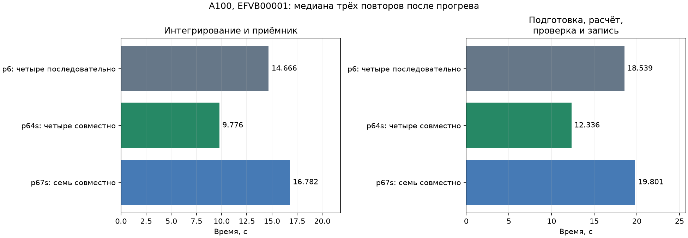

# p64s: точность, скорость и первый чанк EFVB

[Подробная постановка](../../../docs/dev_1_6_p64s_production_spec.txt). Основная область1400×700 м, p6/h10, PML350 без ABC, Рикер30Гц/1Н/м вниз,1с,β1/27,γ0.5,native CFL0.8.140 приёмников x5:10:1395,1001 отсчёт Vx/Vy,FP64. p64s непосредственно рассчитывает только четыре источника100/300/500/700 м на полной сетке. Источники900/1100/1300 не вычисляются и не сохраняются; для плоской модели их можно восстановить зеркально, с изменением знака Vx.

## Точность

Выполнены21 полных запуска обёртки на EFVB00000/00001/02999/02994; внутри семи p6-запусков выполнены28 одиночных интегрирований. Для EFVB00001 —прогрев и3 чередующихся повтора каждого решателя. Всего220 проверок и27 SHA массивов. Оба компонента каждой сейсмограммы сравниваются отдельно; прогрев дополнительно сравнивает все24 строки U/V/A и16 строк памяти PML. Максимальные относительные L2:

- Сейсмограммы p64s против p6/p67s: 3.26403e-14.
- Зеркальные пары, включая центральный источник: 2.82049e-13.
- Конечное состояние: 9.83455e-13.
- Память PML: 3.36589e-14.

Результаты согласованы в пределах округления, побитовое равенство не требуется. Это эквивалентность реализаций, не независимая валидация дифференциальной задачи и не новая сеточная сходимость. Родной шаг совпал у всех решателей: EFVB0 —10000 шагов, EFVB1 —9000, EFVB2999 —8000, EFVB2994 —4000. Последняя модель имеет наименьший maxVp среди первых3000; контроль покрывает наиболее крупный ожидаемый dt. Все терминальные U/V/A и память PML конечны.

## Производительность

| Вариант | Источников | Run, с | Полный замер, с |
|---|---:|---:|---:|
| p6 | 4 | 14.666018 | 18.539128 |
| p64s | 4 | 9.776052 | 12.335582 |
| p67s | 7 | 16.781619 | 19.801323 |

Для требуемых четырёх источников p64s быстрее четырёх одиночных p6 в1.500 раза. Относительно полного пакета семи источников p67s —в1.717 раза, но это разный объём работы. На непосредственно рассчитанный источник приходится2.444 с у p64s и2.397 с у p67s: основной выигрыш относительно p67s связан с исключением трёх зеркальных опытов, а не с ускорением одного состояния. Приёмник асинхронный, его очередь полностью дожидается завершения; SEG-Y и полевых кадров нет. Времена полного замера включают проверку и сохранение, прогревы с дополнительными полными состояниями исключены из медиан.

## Производственный запуск

CPU-аудит всех3000 EFVB прошёл: плоские слои, положительный объёмный модуль, корректные узловые источники и140 приёмников. Перед каждой моделью исходные VP/VS сверяются с SHA этого аудита. Новый отдельный чанк —EFVB00000–02999, четыре источника, массив velocity.npy[1001,4,140,2] и input.npz с исходными VP/VS. Чистые скорости занимают25.06ГиБ, с входами и метаданными около25.3ГиБ; резервируется10МиБ на модель. Общий SQLite DiskGuard сохраняет20ГиБ неснижаемого остатка и20ГиБ рабочего бюджета, учитывает обе GPU и останавливает выдачу при ошибке. Failed/stale автоматически не снимаются, результаты не перезаписываются, следующий чанк не включается.

Фактическое состояние запуска и оценка завершения фиксируются в [снимке очереди](../../../data/dev_1_6_p64s_production/chunk01_v1/launch_snapshot.json); это снимок, а не живой статус. Корень на Saturn: /home/antonov/SeismicDataset/data/dev_1_6_p64s_production/chunk01_v1. Производственные массивы в Git не включаются.

[Метрики сравнения](../../../data/dev_1_6_p64s_production/comparison_v1/analysis/metrics.json) · [Аудит3000 моделей](../../../data/dev_1_6_p64s_production/cpu_v1/check.json) · [Результат очистки](../../../data/dev_1_6_p64s_production/cleanup_v1/completed.json).

Удалено140.04ГиБ старых файлов; после очистки свободно180.09ГиБ. Метаданные старых очередей архивированы и проверены до удаления; исходники, галереи и последние визуальные серии сохранены. Пилот обеих A100:6 моделей за37.980с.

Чанк запущен2026-11-23T14:23:59.587505+00:00. Снимок2026-11-23T14:27:22.513484+00:00: 34 завершены,2 активны,0 ошибок. Среднее полное время11.540с на модель; прогноз окончания2026-11-23T19:12:36.295976+00:00 (UTC), если скорость сохранится. Проекция файлов чанка25.33ГиБ. Это не утверждение о завершении всех3000.
