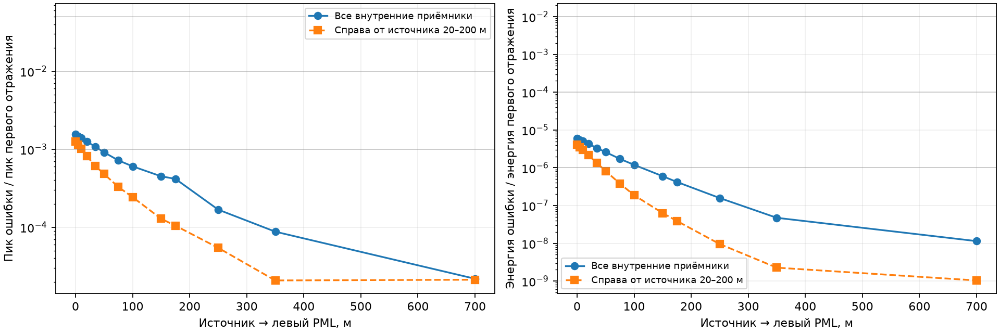
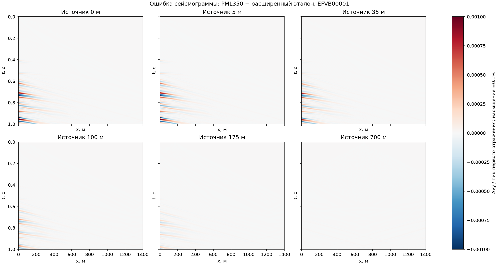
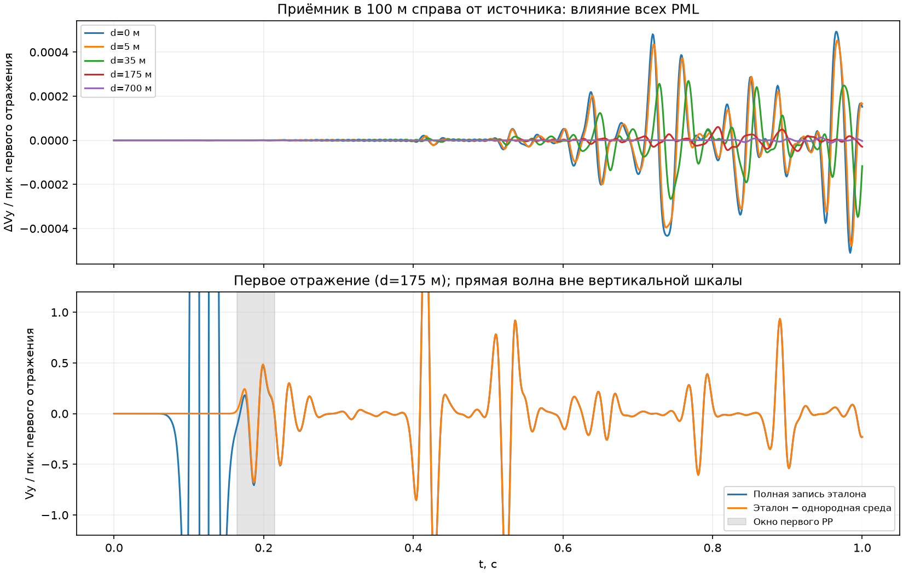

# Источник у PML350: p6, EFVB00001

Проверены29 полных запусков и4 оценки шага на A100. Основная область1400×700 м, EFVB00001 с горизонтами160/390/620 м, p6/h10, Рикер30 Гц, точечная сила вниз1 Н/м,1 с, PML350 без ABC. Все четыре родные оценки CFL0.8 дали dt=1/9000 с; пять контрольных запусков использовали dt/2. Использован фиксированный p6 из проверенного снимка seismic_p67s_v1; p67s имеет фиксированные положения семи источников и для перемещения одиночного источника здесь не подходит.

**Для этой модели опасного скачка при приближении источника к PML не обнаружено.** Даже источник на стыке основной области и слоя даёт пиковую ошибку0.15453% от первого отражения (при dt/2 —0.15504%), то есть примерно в645 раз слабее. Отступ50 м снижает максимум до0.09132%,175 м —до0.04170%. Порог1% проходит уже d=0; порог0.1% по пику впервые проходит d=50 м среди проверенных положений. Это минимальные проверенные расстояния, не точные непрерывные границы допустимости.

Если одновременно требовать пик≤0.1% и интегральную энергию ошибки≤10⁻⁶ энергии первого отражения, первый прошедший отступ —150 м: энергия5.975·10⁻⁷ против1.193·10⁻⁶ при100 м. Величина10⁻⁶ является выбранным строгим допуском; она не следует автоматически из пикового допуска0.1%. Для d=0 энергия ошибки6.060·10⁻⁶ (первое отражение примерно в165000 раз сильнее по этой мере); для175 м —4.201·10⁻⁷. Числитель собирает ошибку за всю1 с по всей внутренней поверхности, знаменатель — только первое отражение в апертуре20–200 м справа от источника. Дополнительно показаны метрики ошибки в той же узкой апертуре; интегралы разных апертур нельзя интерпретировать как локальный коэффициент отражения.

Максимум при d=0 находится у крайнего внутреннего приёмника x≈0.849 м на t=0.940 с. До0.3 с ошибка не превышает0.00210% первого отражения, до0.5 с —0.01546%. Для источников0…175 м максимумы остаются у этого крайнего приёмника и преимущественно в конце записи. После исключения175 м у обоих боков даже d=0 даёт пик0.04312% и энергию4.393·10⁻⁷. Поэтому расстояния источника и приёмников до PML следует рассматривать отдельно. На графиках сейсмограмм показаны также точки x=0/1400 для непрерывности изображения; табличные метрики их исключают.

Контроли только с левым PML воспроизводят основные максимумы: при d=0 —0.154532% против0.154532% с тремя сторонами; при175 м —0.041697% против0.041700%. Следовательно, обнаруженный максимум связан преимущественно с левым оформлением. Этот опыт не разделяет погрешность дискретизации самого слоя и остаточный возврат от его внешнего края; он измеряет их суммарное обратное влияние.

Большие эталоны согласованы с ещё большими областями до2.77·10⁻¹⁴ по L2; прямой источник5 м согласован с переносом эталона до8.66·10⁻¹³. Переносы кратны10 м и сохраняют положение источника относительно GLL-узлов; отдельные эталоны для вершины и середины элемента исключают смешение ошибки источника с ошибкой PML. Нормировка использует разность слоистого и однородного эталонов в окне первого PP, а не поздние переотражения.

При dt/2 пики пограничной ошибки для d0/5/175 меняются примерно на0.33%/0.25%/1.57% относительно самих малых пиков. При этом точечная разность двух ошибок достигает0.02794% первого отражения для d0: форма малой помехи чувствительнее пикового показателя. Сама полная запись при уменьшении dt меняется на0.22–0.26% по L2. Сравнение одинаковых шагов изолирует границу; оно не доказывает абсолютную точность решения или сеточную сходимость.

Практический вывод: для изученной EFVB00001 при30 Гц и записи1 с отступ50 м уже обеспечивает пик ошибки меньше0.1% первого отражения; прежние175 м дают запас. Если достаточно ошибки менее1%, запрета на источник непосредственно у начала PML этот тест не выявляет. Перенос результата на другие модели, частоты, длительности и источник внутри PML требует отдельной проверки. Уменьшение ошибки при удалении источника относится к фиксированному окну1 с, а не к неограниченному времени.

Полные численные метрики: [analysis.json](../../../data/dev_1_6_p67s_showcase/proximity_v1/analysis_v2/analysis.json); положение/время максимумов: [error_locations.json](../../../data/dev_1_6_p67s_showcase/proximity_v1/error_locations.json). Массивы сейсмограмм остаются на Saturn, в репозиторий не включаются. Полевые кадры в этом опыте не сохранялись;21 контроль полного поля на каждом основном запуске подтвердил конечность и побитовое совпадение поверхности, терминальные U/V/A и память PML конечны. Производственная очередь не возобновлялась.

Параметры и ограничения: [постановка](../../../docs/dev_1_6_pml_proximity_spec.txt). Все значения относятся к Vx/Vy внутри основной области за 0–1 с. Энергия — интеграл квадрата скорости по времени и координате, а не поток механической энергии. Нормировка — первое отражение от горизонта в фиксированной правой апертуре 20–200 м.

| Источник–PML, м | Пик ошибки / первое отражение, % | Энергия ошибки / первое отражение, % | L2 ошибки / полной записи, % |
|---:|---:|---:|---:|
| 0 | 0.154532 | 0.000605976 | 0.001416 |
| 5 | 0.146721 | 0.000551023 | 0.00134533 |
| 10 | 0.139435 | 0.000511194 | 0.00128483 |
| 20 | 0.125384 | 0.000431186 | 0.00117543 |
| 35 | 0.107081 | 0.000330903 | 0.0010309 |
| 50 | 0.0913247 | 0.000259854 | 0.000905881 |
| 75 | 0.0719253 | 0.000171798 | 0.000740706 |
| 100 | 0.0603592 | 0.000119314 | 0.000614412 |
| 150 | 0.0449508 | 5.97504e-05 | 0.000435226 |
| 175 | 0.0416996 | 4.20058e-05 | 0.000366928 |
| 250 | 0.0168131 | 1.57773e-05 | 0.000223536 |
| 350 | 0.00877426 | 4.72558e-06 | 0.000122334 |
| 700 | 0.00218597 | 1.14107e-06 | 6.0102e-05 |

Метрики всей основной поверхности включают вклад боковых и нижнего PML. Контроли left_only отделяют левую границу; проверки большей области, прямого переноса источника и dt/2 находятся в analysis.json. Это не универсальный предел для других материалов и частот.
