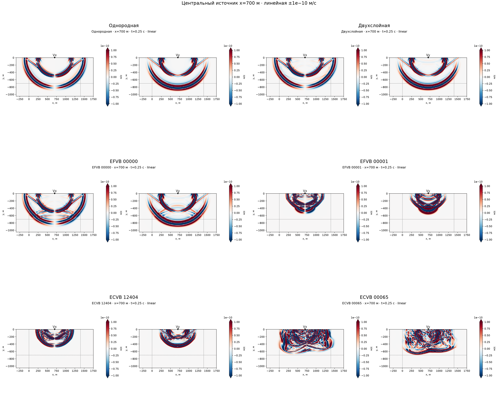
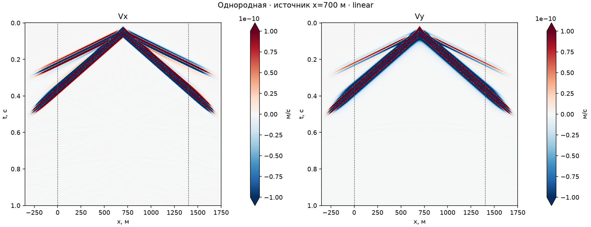
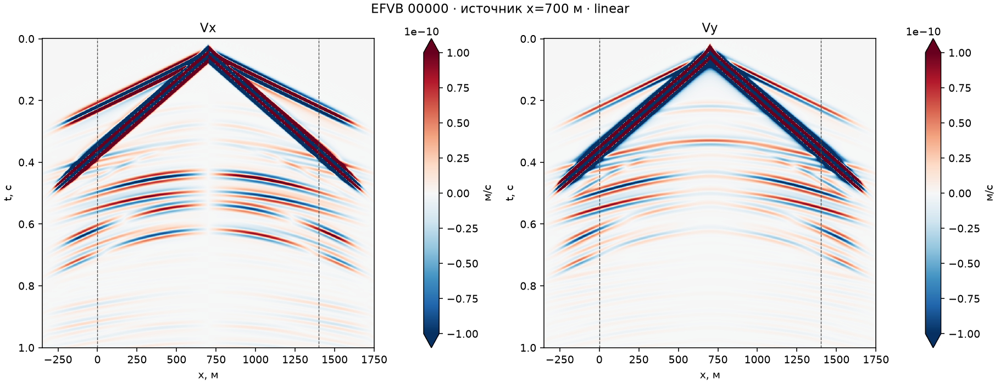
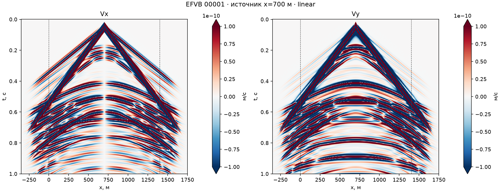
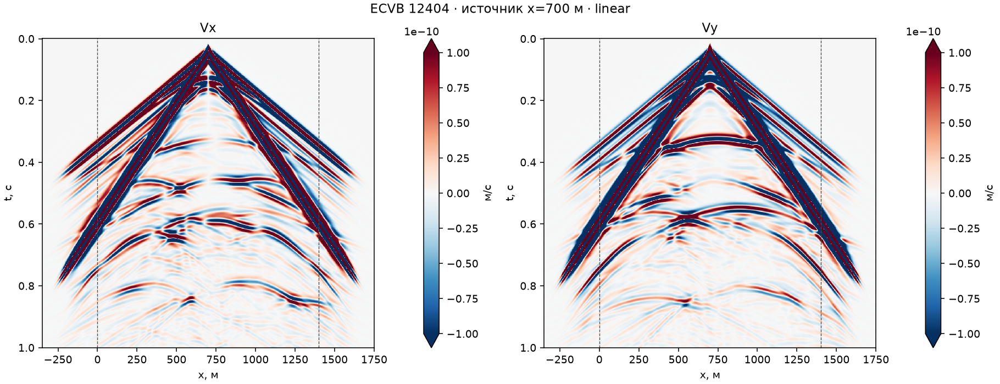
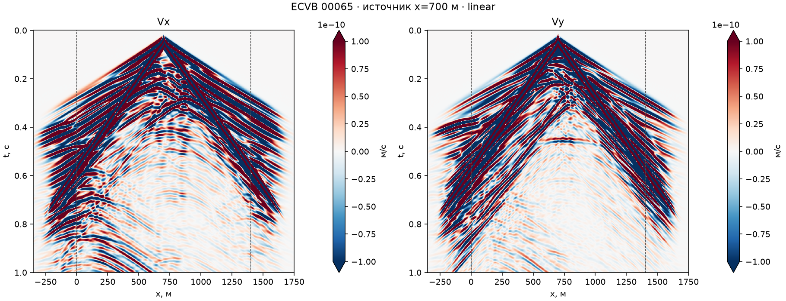

# Глава1.6 · 42 независимых опыта p67s

1400×700 м; p6/h≈10 м; PML350 без ABC;30 Гц;1 с; β1/27; native CFL0.8. [Полная постановка](../../../docs/dev_1_6_p67s_showcase_spec.txt).

Ниже прямые ссылки на MP4 и PNG; они доступны без HTML. [Автономная галерея](index.html) открывается после скачивания. Линейная шкала±1e−10 м/с общая для всех видео и сейсмограмм.

## Однородная

[Материал](homogeneous/material.png) · [Все семь сейсмограмм одним PNG](homogeneous/all_sources_seismograms.png)

| Источник x, м | Анимация Vx/Vy | Сейсмограмма Vx/Vy | Анимация symlog | Сейсмограмма symlog |
|---|---|---|---|---|
| 175 | [MP4](homogeneous/linear/x0175/velocity.mp4) | [PNG](homogeneous/linear/x0175/seismogram.png) | [MP4](homogeneous/symlog/x0175/velocity.mp4) | [PNG](homogeneous/symlog/x0175/seismogram.png) |
| 350 | [MP4](homogeneous/linear/x0350/velocity.mp4) | [PNG](homogeneous/linear/x0350/seismogram.png) | [MP4](homogeneous/symlog/x0350/velocity.mp4) | [PNG](homogeneous/symlog/x0350/seismogram.png) |
| 525 | [MP4](homogeneous/linear/x0525/velocity.mp4) | [PNG](homogeneous/linear/x0525/seismogram.png) | [MP4](homogeneous/symlog/x0525/velocity.mp4) | [PNG](homogeneous/symlog/x0525/seismogram.png) |
| 700 | [MP4](homogeneous/linear/x0700/velocity.mp4) | [PNG](homogeneous/linear/x0700/seismogram.png) | [MP4](homogeneous/symlog/x0700/velocity.mp4) | [PNG](homogeneous/symlog/x0700/seismogram.png) |
| 875 | [MP4](homogeneous/linear/x0875/velocity.mp4) | [PNG](homogeneous/linear/x0875/seismogram.png) | [MP4](homogeneous/symlog/x0875/velocity.mp4) | [PNG](homogeneous/symlog/x0875/seismogram.png) |
| 1050 | [MP4](homogeneous/linear/x1050/velocity.mp4) | [PNG](homogeneous/linear/x1050/seismogram.png) | [MP4](homogeneous/symlog/x1050/velocity.mp4) | [PNG](homogeneous/symlog/x1050/seismogram.png) |
| 1225 | [MP4](homogeneous/linear/x1225/velocity.mp4) | [PNG](homogeneous/linear/x1225/seismogram.png) | [MP4](homogeneous/symlog/x1225/velocity.mp4) | [PNG](homogeneous/symlog/x1225/seismogram.png) |

## Двухслойная

[Материал](two_layer/material.png) · [Все семь сейсмограмм одним PNG](two_layer/all_sources_seismograms.png)

| Источник x, м | Анимация Vx/Vy | Сейсмограмма Vx/Vy | Анимация symlog | Сейсмограмма symlog |
|---|---|---|---|---|
| 175 | [MP4](two_layer/linear/x0175/velocity.mp4) | [PNG](two_layer/linear/x0175/seismogram.png) | [MP4](two_layer/symlog/x0175/velocity.mp4) | [PNG](two_layer/symlog/x0175/seismogram.png) |
| 350 | [MP4](two_layer/linear/x0350/velocity.mp4) | [PNG](two_layer/linear/x0350/seismogram.png) | [MP4](two_layer/symlog/x0350/velocity.mp4) | [PNG](two_layer/symlog/x0350/seismogram.png) |
| 525 | [MP4](two_layer/linear/x0525/velocity.mp4) | [PNG](two_layer/linear/x0525/seismogram.png) | [MP4](two_layer/symlog/x0525/velocity.mp4) | [PNG](two_layer/symlog/x0525/seismogram.png) |
| 700 | [MP4](two_layer/linear/x0700/velocity.mp4) | [PNG](two_layer/linear/x0700/seismogram.png) | [MP4](two_layer/symlog/x0700/velocity.mp4) | [PNG](two_layer/symlog/x0700/seismogram.png) |
| 875 | [MP4](two_layer/linear/x0875/velocity.mp4) | [PNG](two_layer/linear/x0875/seismogram.png) | [MP4](two_layer/symlog/x0875/velocity.mp4) | [PNG](two_layer/symlog/x0875/seismogram.png) |
| 1050 | [MP4](two_layer/linear/x1050/velocity.mp4) | [PNG](two_layer/linear/x1050/seismogram.png) | [MP4](two_layer/symlog/x1050/velocity.mp4) | [PNG](two_layer/symlog/x1050/seismogram.png) |
| 1225 | [MP4](two_layer/linear/x1225/velocity.mp4) | [PNG](two_layer/linear/x1225/seismogram.png) | [MP4](two_layer/symlog/x1225/velocity.mp4) | [PNG](two_layer/symlog/x1225/seismogram.png) |

## EFVB 00000

[Материал](EFVB00000/material.png) · [Все семь сейсмограмм одним PNG](EFVB00000/all_sources_seismograms.png)

| Источник x, м | Анимация Vx/Vy | Сейсмограмма Vx/Vy | Анимация symlog | Сейсмограмма symlog |
|---|---|---|---|---|
| 175 | [MP4](EFVB00000/linear/x0175/velocity.mp4) | [PNG](EFVB00000/linear/x0175/seismogram.png) | [MP4](EFVB00000/symlog/x0175/velocity.mp4) | [PNG](EFVB00000/symlog/x0175/seismogram.png) |
| 350 | [MP4](EFVB00000/linear/x0350/velocity.mp4) | [PNG](EFVB00000/linear/x0350/seismogram.png) | [MP4](EFVB00000/symlog/x0350/velocity.mp4) | [PNG](EFVB00000/symlog/x0350/seismogram.png) |
| 525 | [MP4](EFVB00000/linear/x0525/velocity.mp4) | [PNG](EFVB00000/linear/x0525/seismogram.png) | [MP4](EFVB00000/symlog/x0525/velocity.mp4) | [PNG](EFVB00000/symlog/x0525/seismogram.png) |
| 700 | [MP4](EFVB00000/linear/x0700/velocity.mp4) | [PNG](EFVB00000/linear/x0700/seismogram.png) | [MP4](EFVB00000/symlog/x0700/velocity.mp4) | [PNG](EFVB00000/symlog/x0700/seismogram.png) |
| 875 | [MP4](EFVB00000/linear/x0875/velocity.mp4) | [PNG](EFVB00000/linear/x0875/seismogram.png) | [MP4](EFVB00000/symlog/x0875/velocity.mp4) | [PNG](EFVB00000/symlog/x0875/seismogram.png) |
| 1050 | [MP4](EFVB00000/linear/x1050/velocity.mp4) | [PNG](EFVB00000/linear/x1050/seismogram.png) | [MP4](EFVB00000/symlog/x1050/velocity.mp4) | [PNG](EFVB00000/symlog/x1050/seismogram.png) |
| 1225 | [MP4](EFVB00000/linear/x1225/velocity.mp4) | [PNG](EFVB00000/linear/x1225/seismogram.png) | [MP4](EFVB00000/symlog/x1225/velocity.mp4) | [PNG](EFVB00000/symlog/x1225/seismogram.png) |

## EFVB 00001

[Материал](EFVB00001/material.png) · [Все семь сейсмограмм одним PNG](EFVB00001/all_sources_seismograms.png)

| Источник x, м | Анимация Vx/Vy | Сейсмограмма Vx/Vy | Анимация symlog | Сейсмограмма symlog |
|---|---|---|---|---|
| 175 | [MP4](EFVB00001/linear/x0175/velocity.mp4) | [PNG](EFVB00001/linear/x0175/seismogram.png) | [MP4](EFVB00001/symlog/x0175/velocity.mp4) | [PNG](EFVB00001/symlog/x0175/seismogram.png) |
| 350 | [MP4](EFVB00001/linear/x0350/velocity.mp4) | [PNG](EFVB00001/linear/x0350/seismogram.png) | [MP4](EFVB00001/symlog/x0350/velocity.mp4) | [PNG](EFVB00001/symlog/x0350/seismogram.png) |
| 525 | [MP4](EFVB00001/linear/x0525/velocity.mp4) | [PNG](EFVB00001/linear/x0525/seismogram.png) | [MP4](EFVB00001/symlog/x0525/velocity.mp4) | [PNG](EFVB00001/symlog/x0525/seismogram.png) |
| 700 | [MP4](EFVB00001/linear/x0700/velocity.mp4) | [PNG](EFVB00001/linear/x0700/seismogram.png) | [MP4](EFVB00001/symlog/x0700/velocity.mp4) | [PNG](EFVB00001/symlog/x0700/seismogram.png) |
| 875 | [MP4](EFVB00001/linear/x0875/velocity.mp4) | [PNG](EFVB00001/linear/x0875/seismogram.png) | [MP4](EFVB00001/symlog/x0875/velocity.mp4) | [PNG](EFVB00001/symlog/x0875/seismogram.png) |
| 1050 | [MP4](EFVB00001/linear/x1050/velocity.mp4) | [PNG](EFVB00001/linear/x1050/seismogram.png) | [MP4](EFVB00001/symlog/x1050/velocity.mp4) | [PNG](EFVB00001/symlog/x1050/seismogram.png) |
| 1225 | [MP4](EFVB00001/linear/x1225/velocity.mp4) | [PNG](EFVB00001/linear/x1225/seismogram.png) | [MP4](EFVB00001/symlog/x1225/velocity.mp4) | [PNG](EFVB00001/symlog/x1225/seismogram.png) |

## ECVB 12404

[Материал](ECVB12404/material.png) · [Все семь сейсмограмм одним PNG](ECVB12404/all_sources_seismograms.png)

| Источник x, м | Анимация Vx/Vy | Сейсмограмма Vx/Vy | Анимация symlog | Сейсмограмма symlog |
|---|---|---|---|---|
| 175 | [MP4](ECVB12404/linear/x0175/velocity.mp4) | [PNG](ECVB12404/linear/x0175/seismogram.png) | [MP4](ECVB12404/symlog/x0175/velocity.mp4) | [PNG](ECVB12404/symlog/x0175/seismogram.png) |
| 350 | [MP4](ECVB12404/linear/x0350/velocity.mp4) | [PNG](ECVB12404/linear/x0350/seismogram.png) | [MP4](ECVB12404/symlog/x0350/velocity.mp4) | [PNG](ECVB12404/symlog/x0350/seismogram.png) |
| 525 | [MP4](ECVB12404/linear/x0525/velocity.mp4) | [PNG](ECVB12404/linear/x0525/seismogram.png) | [MP4](ECVB12404/symlog/x0525/velocity.mp4) | [PNG](ECVB12404/symlog/x0525/seismogram.png) |
| 700 | [MP4](ECVB12404/linear/x0700/velocity.mp4) | [PNG](ECVB12404/linear/x0700/seismogram.png) | [MP4](ECVB12404/symlog/x0700/velocity.mp4) | [PNG](ECVB12404/symlog/x0700/seismogram.png) |
| 875 | [MP4](ECVB12404/linear/x0875/velocity.mp4) | [PNG](ECVB12404/linear/x0875/seismogram.png) | [MP4](ECVB12404/symlog/x0875/velocity.mp4) | [PNG](ECVB12404/symlog/x0875/seismogram.png) |
| 1050 | [MP4](ECVB12404/linear/x1050/velocity.mp4) | [PNG](ECVB12404/linear/x1050/seismogram.png) | [MP4](ECVB12404/symlog/x1050/velocity.mp4) | [PNG](ECVB12404/symlog/x1050/seismogram.png) |
| 1225 | [MP4](ECVB12404/linear/x1225/velocity.mp4) | [PNG](ECVB12404/linear/x1225/seismogram.png) | [MP4](ECVB12404/symlog/x1225/velocity.mp4) | [PNG](ECVB12404/symlog/x1225/seismogram.png) |

## ECVB 00065

[Материал](ECVB00065/material.png) · [Все семь сейсмограмм одним PNG](ECVB00065/all_sources_seismograms.png)

| Источник x, м | Анимация Vx/Vy | Сейсмограмма Vx/Vy | Анимация symlog | Сейсмограмма symlog |
|---|---|---|---|---|
| 175 | [MP4](ECVB00065/linear/x0175/velocity.mp4) | [PNG](ECVB00065/linear/x0175/seismogram.png) | [MP4](ECVB00065/symlog/x0175/velocity.mp4) | [PNG](ECVB00065/symlog/x0175/seismogram.png) |
| 350 | [MP4](ECVB00065/linear/x0350/velocity.mp4) | [PNG](ECVB00065/linear/x0350/seismogram.png) | [MP4](ECVB00065/symlog/x0350/velocity.mp4) | [PNG](ECVB00065/symlog/x0350/seismogram.png) |
| 525 | [MP4](ECVB00065/linear/x0525/velocity.mp4) | [PNG](ECVB00065/linear/x0525/seismogram.png) | [MP4](ECVB00065/symlog/x0525/velocity.mp4) | [PNG](ECVB00065/symlog/x0525/seismogram.png) |
| 700 | [MP4](ECVB00065/linear/x0700/velocity.mp4) | [PNG](ECVB00065/linear/x0700/seismogram.png) | [MP4](ECVB00065/symlog/x0700/velocity.mp4) | [PNG](ECVB00065/symlog/x0700/seismogram.png) |
| 875 | [MP4](ECVB00065/linear/x0875/velocity.mp4) | [PNG](ECVB00065/linear/x0875/seismogram.png) | [MP4](ECVB00065/symlog/x0875/velocity.mp4) | [PNG](ECVB00065/symlog/x0875/seismogram.png) |
| 1050 | [MP4](ECVB00065/linear/x1050/velocity.mp4) | [PNG](ECVB00065/linear/x1050/seismogram.png) | [MP4](ECVB00065/symlog/x1050/velocity.mp4) | [PNG](ECVB00065/symlog/x1050/seismogram.png) |
| 1225 | [MP4](ECVB00065/linear/x1225/velocity.mp4) | [PNG](ECVB00065/linear/x1225/seismogram.png) | [MP4](ECVB00065/symlog/x1225/velocity.mp4) | [PNG](ECVB00065/symlog/x1225/seismogram.png) |

